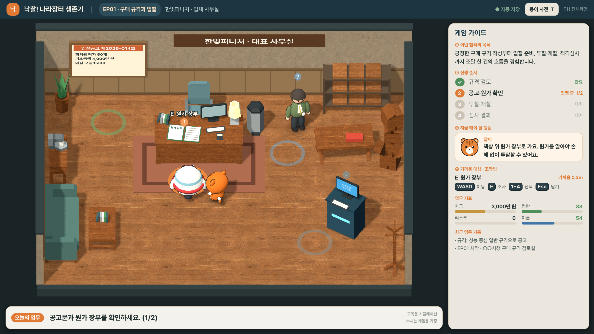

# 낙찰! 나라장터 생존기

Godot 4.7.2로 만든 공공조달 업무 체험 3D 교육 시뮬레이션입니다. 플레이어는 나라미를 키보드로 움직여 업무 공간의 문서·담당자·단말을 직접 조사합니다. 달이는 옆에서 따라다니며 현재 목적과 다음 행동을 안내합니다.



## 웹에서 플레이

웹 빌드(`build/web/`)를 정적 서버로 열면 브라우저에서 플레이할 수 있습니다. GitHub Pages 배포 후 공개 주소를 여기에 적습니다.

```sh
python3 -m http.server 8765 --directory build/web
# 브라우저에서 http://localhost:8765 열기
```

- 데스크톱 Chrome·Edge·Safari 최신 버전을 권장합니다. 키보드가 필요해 모바일은 지원하지 않습니다.
- 첫 로딩에 약 40MB를 내려받습니다.
- 진행 상황은 브라우저 저장소에 저장됩니다.

## 실행

1. Godot 4.7.2 Project Manager에서 `project.godot`를 가져옵니다.
2. 프로젝트를 열고 `F5`로 실행합니다.
3. 타이틀에서 **1 업무 시작**(또는 **2 이어하기**)을 누릅니다.

명령줄에서 바로 실행할 수도 있습니다.

```sh
"/Users/yangsang-yun/Downloads/Godot.app/Contents/MacOS/Godot" --path .
```

- 기준 해상도는 1280×720 캔버스이며, `canvas_items` 스트레치로 2560×1440까지 선명하게 확대됩니다.
- 시연 영상은 `F11` 전체화면으로 녹화하는 것을 권장합니다.
- 렌더러는 GL Compatibility입니다. 실시간 광원은 방향광 2개(그림자 1개)만 쓰고 후처리는 사용하지 않습니다.

### 웹 빌드·배포

```sh
"/Users/yangsang-yun/Downloads/Godot.app/Contents/MacOS/Godot" --headless --path . --export-release "Web" build/web/index.html
```

- `export_presets.cfg`의 Web 프리셋은 GitHub Pages에서 바로 돌아가도록 단일 스레드(`thread_support=false`)로 내보냅니다.
- 결과물 `build/web/`을 `gh-pages` 브랜치에 올리면 배포됩니다.

### 성공 과정 시연 영상

`videos/`에 챕터별 이상적인 성공 루트를 실제 게임 화면으로 녹화한 영상이 있습니다(1920×1080, 30fps, 효과음·배경음 포함).

| 파일 | 길이 | 내용 |
|---|---|---|
| `videos/ep01_success.mp4` | 1분 33초 | 시나리오 컷신 → 요청서·견본 조사 → 성능 중심 규격 → 공고·원가 확인 → 예비가격·투찰 1순위 → 보관함에서 실제 실적 발견 → 사실대로 제출, 적격심사 통과 |
| `videos/ep02_success.mp4` | 57초 | 시나리오 컷신 → 균형형 등록 → 구매 비교 → 상생세일 참여 → 3분기 가격 인하 반영 → 4분기 손익표 |

나라미가 자동 조작(autopilot)으로 실제 걸어가 조사·선택하며, 단계 자막과 시작·끝 타이틀 카드를 덧붙입니다. 다시 녹화하려면 1080p 창 크기를 지정하는 `override.cfg`를 잠시 두고 Godot 무비 라이터로 녹화한 뒤 ffmpeg로 MP4로 변환합니다.

```sh
printf '[display]\nwindow/size/window_width_override=1920\nwindow/size/window_height_override=1080\n' > override.cfg
"/Users/yangsang-yun/Downloads/Godot.app/Contents/MacOS/Godot" --path . --fixed-fps 30 --write-movie build/video/ep01.avi -- --video=ep01
ffmpeg -i build/video/ep01.avi -c:v libx264 -crf 20 -pix_fmt yuv420p -c:a aac videos/ep01_success.mp4
rm override.cfg
```

### Unity 오프닝 시네마틱

`videos/opening_cinematic_unity.mp4`(21초, 1920×1080, 배경음 포함)는 게임의 네 공간과 나라미·달이를 Unity로 옮겨 원근 카메라로 연출한 오프닝 영상입니다. 시청 → 업체 → 조달청 → 쇼핑몰을 차례로 비추고, 두 캐릭터와 타이틀로 끝납니다.

- **Unity 프로젝트**: `unity_cinematic/` (Unity 6000.6.7f1, Built-in 렌더 파이프라인)
- **사용 패키지**: glTFast 6.20.0 (glb 가져오기)
- **연출 스크립트**: `Assets/Editor/CinematicRenderer.cs`. 카메라 경로·자막·타이틀·조명을 정하고, 1920×1080 PNG 프레임을 렌더링합니다.
- **3D 장면 내보내기**: `scripts/dev/gltf_export.gd`가 Godot에서 방 4개와 캐릭터 2개를 `build/unity_export/*.glb`로 내보냅니다. 이 파일은 `Assets/Imported/`로 복사해 쓰며, 다시 만들 수 있어 Git에는 올리지 않습니다.
- 게임 플레이 화면이 아니라 연출 영상입니다. 실제 플레이는 `ep01_success.mp4`·`ep02_success.mp4`가 보여 줍니다.

다시 만들려면:

```sh
"/Users/yangsang-yun/Downloads/Godot.app/Contents/MacOS/Godot" --path . -s res://scripts/dev/gltf_export.gd
mkdir -p unity_cinematic/Assets/Imported && cp build/unity_export/*.glb unity_cinematic/Assets/Imported/
/Applications/Unity/Hub/Editor/6000.6.7f1/Unity.app/Contents/MacOS/Unity -batchmode -projectPath unity_cinematic -executeMethod CinematicRenderer.Render -quit
ffmpeg -framerate 30 -i build/unity_frames/frame_%05d.png -c:v libx264 -crf 19 -pix_fmt yuv420p videos/opening_cinematic_unity.mp4
```

### 자동 캡처

아래 명령을 실행하면 두 챕터를 자동으로 진행하면서 `screenshots/`에 장면별 PNG를 저장합니다. 캡처 모드에서는 저장 파일을 건드리지 않습니다.

```sh
"/Users/yangsang-yun/Downloads/Godot.app/Contents/MacOS/Godot" --path . --resolution 2560x1440 -- --capture
```

## 조작

| 키 | 동작 |
|---|---|
| `WASD` / 방향키 | 이동 |
| `E` / `Enter` | 가까운 대상 조사·상호작용 |
| `1`~`4` | 대화·업무 창 선택지 |
| `Esc` | 대화·업무 창 닫기 (결과 창은 선택이 필요) |
| `T` | 용어 사전 |
| `F11` | 전체화면 |

키는 키보드의 물리적 위치로 인식하므로, 한글 입력 상태에서도 WASD와 숫자키가 동작합니다. 창이 열려 있는 동안에는 캐릭터가 움직이지 않습니다. 상호작용 대상의 바닥 링과 핀 색은 상태를 나타냅니다.

- 주황 `!`: 지금 할 일
- 청록 `?`: 조사 가능
- 회색: 잠김
- 초록 `✓`: 확인함

## 화면 구성

- **타이틀 화면**: 나라미와 달이가 무대 위에서 번갈아 손짓하고, 서류·동전·도장이 떠다니는 3D 장면입니다.
- **챕터 시나리오 컷신**: 각 챕터를 시작할 때 15~20초 동안 재생됩니다. 카메라가 업무 공간을 비추고, 등장인물 대사가 아래 자막으로 나옵니다. `Enter`·`Esc`·`Space`·`E`로 건너뛸 수 있습니다. 대본은 `scripts/core/chapter_data.gd`의 `SCENARIO`에 있습니다.

- **우측 게임 가이드**: ① 챕터 목적 ② 진행 순서(완료·진행 중·대기) ③ 지금 해야 할 행동과 달이의 안내 ④ 가까운 대상과 조작법, 그리고 업무 지표와 최근 기록
- **하단 오늘의 업무**: 현재 단계에서 할 다음 행동
- **챕터 브리핑**: 각 챕터 시작 시 역할·상황·학습 목표·진행 순서를 보여 줍니다.
- **피드백**: 조사·선택·성공·실패마다 다른 효과음, 토스트, 캐릭터 동작이 나옵니다. 성공하면 환호, 실패하면 시무룩한 동작과 창 흔들림이 나옵니다. 결과 창에는 평판·리스크 등의 변화량이 칩으로 표시됩니다.

## 챕터 목표와 흐름

### EP01 구매 규격과 입찰

**목표:** 공정한 구매 규격 작성부터 입찰 준비, 투찰·개찰, 적격심사까지 조달 한 건의 흐름을 경험합니다.

**순서:** 규격 검토 → 공고·원가 확인 → 투찰·개찰 → 심사 결과

1. **○○시청 구매 규격 검토실**: 구매 요청서와 견본 탁자를 조사한 뒤 규격을 고릅니다. 선택지는 성능 중심 / 특정 모델 지정 / 성능 기준 누락 세 가지입니다. 규정집은 선택 조사입니다.
2. **한빛퍼니처 업체 사무실**: 입찰공고와 원가 장부를 확인하면 입찰 단말이 열립니다. 박 실장의 관행 메모는 받을지 말지 고를 수 있습니다.
3. **입찰 단말**: 15개 복수예비가격 중 2개를 고르고 투찰률을 조정해 제출합니다. 개찰 결과에서 추첨된 4개, 예정가격, 낙찰하한선, 순위표를 확인합니다. 2순위 이하거나 하한 미달이면 재투찰(재공고 가정) 또는 결과 기록 후 진행 중에서 고릅니다.
4. **조달청 적격심사실**: 1순위일 때 들어갑니다. 심사 기준표와 제출 서류철을 확인하고, 선택 조사인 보관함에서 실제 납품확인서를 찾으면 점수가 오릅니다. 접수 창구에서는 사실대로 제출 / 허위 서류 / 포기 중 하나를 고르며, 결과가 점수표·평판·리스크로 반영됩니다.

### EP02 종합쇼핑몰

**목표:** 상품의 가격·납기·디자인과 판매촉진 선택이 매출과 이익에 미치는 영향을 비교합니다.

**순서:** 상품 등록 → 구매 비교 → 판매 방식 선택 → 4분기 손익 확인

1. **상품 등록대**: 실속형 / 균형형 / 디자인형 중 하나를 등록합니다.
2. **구매 비교 · 이 주무관**: 가격 60%·납기 22%·디자인 18% 점수로 경쟁 상품과 비교합니다. 조건은 1회 다시 정할 수 있습니다.
3. **분기 판매 단말**: 상생세일 참여 여부를 고릅니다. 3분기에는 원자재 가격 변화에 따라 가격 조정 여부를 정합니다.
4. **4분기 손익표**: 판매량·매출·원가·이익을 보여 주고, 다른 상품·판매 방식을 골랐다면 어땠을지도 비교합니다.

### 게임용 가정

다음 수치와 규칙은 학습을 위한 **게임용 가정**이며, 화면에도 `게임용 가정 수치` 배지로 표시됩니다.

- 기초금액, 원가
- 경쟁사 투찰 범위
- 적격심사 배점(실적 40·경영 25·가격 30·신인도 ±5, 85점 통과)
- 쇼핑몰 수요·점유율 공식, 상생세일 효과
- 평판·리스크 변화량

실제 제도는 기관·금액 구간에 따라 다릅니다. 수치는 `scripts/core/procurement_rules.gd`에서 조정합니다.

## 프로젝트 구조

```
scenes/main.tscn                  진입 씬
scripts/main.gd                   게임 흐름·입력·저장(챕터 진행 오케스트레이션)
scripts/core/procurement_rules.gd 예비가격·개찰·적격심사·쇼핑몰 계산
scripts/core/chapter_data.gd      챕터 목표·진행 순서·단계별 목표/달이 안내 문구
scripts/world/room_builder.gd     네 개의 업무 공간 배치와 상호작용 지점
scripts/world/props.gd            재질·절차 텍스처·가구 빌더
scripts/world/interact_marker.gd  상호작용 링·핀·이름표
scripts/actors/mascot_actor.gd    나라미·달이 절차 생성 메시와 애니메이션
scripts/actors/npc_actor.gd       담당자 NPC
scripts/ui/hud.gd                 상단 바·게임 가이드·오늘의 업무·토스트
scripts/ui/modal.gd               대화·업무 창
scripts/ui/ui_theme.gd, dali_icon.gd
scripts/audio/sound_bank.gd       절차 합성 효과음·배경음
scripts/dev/capture_director.gd   자동 캡처(개발용)
scripts/dev/video_director.gd     성공 과정 시연 영상 자동 연출(개발용)
assets/models/kenney/             CC0 가구 모델(Kenney)
assets/textures/                  CC0 바닥·벽 텍스처(Poly Haven)
videos/                           성공 과정 시연 영상 + Unity 오프닝 시네마틱
unity_cinematic/                  오프닝 시네마틱용 Unity 프로젝트
scripts/dev/gltf_export.gd        방·캐릭터 glb 내보내기(Unity 연출용)
screenshots/                      챕터·공간별 실행 캡처
```

저장 파일은 `user://nakchal-save.json`(save_version 3)입니다. 이전 버전 저장 데이터는 구조가 달라 불러오지 않고 새로 시작합니다.

## 에셋 출처와 한계

- **가구·소품 3D 모델**: [Kenney Furniture Kit 2.0](https://kenney.nl/assets/furniture-kit) — Kenney, **CC0 1.0**
  - 책상·의자·책장·소파·화분·러그·상자 등 39종을 `assets/models/kenney/`에 포함했습니다. 라이선스: `assets/models/kenney/Kenney-License.txt`
  - 원래의 파스텔 단색 재질은 `Props.kit_material()`에서 원목 사진 질감과 공간별 색으로 바꿔 씁니다.
- **바닥·벽 사진 텍스처**: [Poly Haven](https://polyhaven.com) — **CC0 1.0**
  - `oak_wood_planks`, `laminate_floor_02`, `herringbone_parquet`, `painted_plaster_wall` (1K 컬러·노멀 맵)을 `assets/textures/`에 포함했습니다.
  - 쇼핑몰 타일 바닥과 일부 소품은 코드로 생성합니다.
- **사운드**: 효과음과 배경음은 `sound_bank.gd`에서 사인파로 합성합니다(외부 파일 없음).
- **시연 영상 인코딩**: ffmpeg 7.1(imageio-ffmpeg 배포 바이너리)로 변환했습니다. 영상 파일 자체에는 위 에셋과 게임 화면만 들어 있습니다.
- **글꼴**: [Pretendard](https://github.com/orioncactus/pretendard) v1.3.9 Medium·Bold
  - © 2021 Kil Hyung-jin, SIL Open Font License 1.1
  - 웹 빌드에서도 한글이 보이도록 `fonts/`에 포함했습니다.
  - 라이선스 전문: [fonts/Pretendard-LICENSE.txt](fonts/Pretendard-LICENSE.txt)
- **나라미·달이**: 사용자 제공 참고 이미지의 특징을 바탕으로 만든 절차 생성 메시입니다.
  - 나라미: 둥근 흰 몸, 하늘색 바이저, 검은 눈과 하이라이트, 주황 부리·발, 빨간 스카프, 어두운 날개 끝
  - 달이: 주황 머리와 귀, 이마 줄무늬 세 개, 흰 주둥이·배·꼬리 끝
  - **정식 리깅 3D 모델이 없어 다음 한계가 있습니다.**
	- 형태는 타원체와 표면 패치의 조합이라 원본 일러스트의 미세한 곡선을 그대로 재현하지 못합니다.
	- 뼈대 없이 노드 단위(몸·날개/팔·발·꼬리)로만 움직입니다. 걷기·대기·방향 전환·눈 깜빡임·조사·안내·환호·실망 동작은 단순한 회전·이동으로 표현합니다.
	- 표정은 바꿀 수 없습니다(눈 깜빡임만 가능).
  - 정식 모델(glTF)이 생기면 `mascot_actor.gd`의 `build()`를 교체해 쓸 수 있습니다.
- 프로젝트 폴더 안에서 참고 PNG를 찾지 못했습니다. 그래서 작업 지시서에 적힌 캐릭터 특징을 기준으로 제작했습니다.
