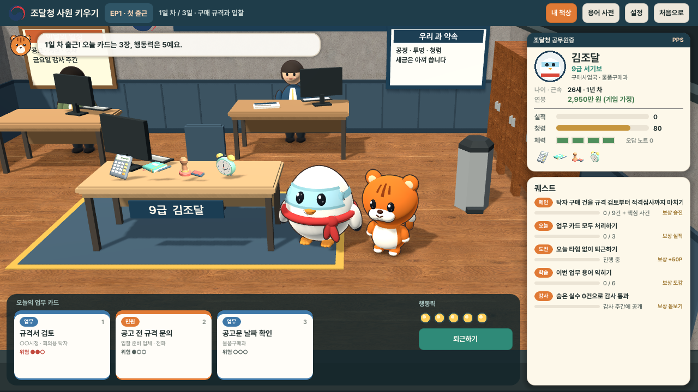

# 낙찰! 조달청 사원 키우기

Godot 4.7.2로 만든 공공조달 교육 시뮬레이션입니다. 플레이어는 조달청에 갓 임용된 **9급 서기보**가 되어, 구매 규격·입찰·적격심사(EP1), 종합쇼핑몰(EP2), 납품·검사·대금(EP3) 업무를 카드로 처리하며 6급 주사까지 성장합니다. 달이가 옆에서 힌트를 주고, 조달청 사무실 책상에는 승진·교육·구입으로 얻은 비품이 하나씩 놓입니다.



## 조달청 사원 키우기 (v2.0 기본 모드)

시작 화면에서 **게임 시작**을 누르고 이름을 정하면 첫 출근이 시작됩니다. 에피소드 3개, 한 편에 약 6~8분입니다. 누구나 끝까지 갈 수 있고, 선택에 따라 평가 등급·책상 비품·엔딩이 달라집니다.

| 흐름 | 내용 |
|---|---|
| 브리핑 | 팀장(과장)이 이번 달 업무를 알려 줍니다. |
| 업무 3일 | 하루에 카드 3장, 행동력 5. 카드는 사무실 곳곳(내 자리 · 민원 창구 · 응접 테이블 · 출입구 · 최 주무관 자리)에 주황색 표시로 놓여 있고, 나라미를 걸어가게 해 **E**를 누르면 카드지가 펼쳐집니다. 카드마다 **꼼꼼히(2) · 빠르게(1) · 편하게(0)** 중 하나를 고릅니다. 위험도가 높은 카드를 빠르게 처리하면 숨은 실수가 생길 수 있고, 편하게(타협) 처리하면 청렴이 깎입니다. 행동력이 모자라면 카드를 다음 날로 미루거나(기한 초과 시 실적 -1), 체력을 써서 야근합니다. |
| 핵심 사건 | 3일 차 퇴근 전에 **팀장 자리**로 가서 엽니다. 허위 실적 증명서(EP1), 담합 제보(EP2), 연말의 무리한 지시(EP3)를 두 단계 선택으로 해결합니다. |
| 금요일 감사 주간 | 빠르게 처리한 카드의 숨은 실수와 타협이 공개됩니다. 실수는 **오답 노트**로 쌓입니다. |
| 용어 퀴즈 · 임용장 | 퀴즈 3문제 뒤 S/A/B/C 평가와 함께 승진합니다. 연봉·성과급·복지포인트가 오르고 새 비품이 책상에 놓입니다. |
| 엔딩 | EP3 뒤 청렴·실수·야근·평가에 따라 5가지 엔딩(청렴 에이스, 믿음직한 주무관, 열정 과다, 아슬아슬 생존왕, 다시 배우는 공무원) 중 하나를 봅니다. |

- **오른쪽 패널**: 공무원증(이름·직급·소속·나이·연봉·실적·청렴·체력·보유 스킬)과 퀘스트(메인·오늘·도전·학습·감사)
- **내 책상**: 상단 **내 책상** 버튼. 기본 지급·승진 지급·표창·교육(스킬)·구내매점(복지포인트) 비품을 봅니다. 비품은 실제로 효과가 있습니다(계산기: 가격 카드 행동력 -1, 결재 도장: 하루 한 번 숨은 실수 방지, 돋보기: 하루 한 번 미리 확인, 형광펜: 함정 문구 표시, 듀얼 모니터: 행동력 +1, 커피·비타민: 체력 회복 등).
- **카드지**: 그림·한 줄 상황·첨부 문서·선택 타일 3개(행동력 동전, 위험 표시)로 보여 주고, 고르면 도장과 함께 결과 한 줄·오늘의 배움·수치가 나옵니다. 수치는 나라미 머리 위에도 떠오릅니다.
- **조작**: `WASD`·방향키(터치는 조이스틱)로 걷기, 표시 앞에서 `E`·`Space`(터치는 큰 버튼)로 열기, 카드지 선택은 `1~3`, 결과 확인 `Enter`, 닫기 `Esc`. 아래 "오늘 할 일"을 누르면 그 자리를 알려 줍니다. 업무가 끝나면 출입구에서 `E` 또는 [퇴근하기]
- **저장**: `user://nakchal-career.json` (진행 중인 단계부터 이어하기)
- **데이터**: 카드·에피소드·엔딩 `scripts/core/career_data.gd`, 화면과 흐름 `scripts/career/career_screen.gd`, 조달청 사무실 `scripts/world/room_builder.gd`의 `_pps_office`
- 이전 버전인 **업체 편**(한빛퍼니처 대표로 방을 걸어 다니는 EP01~03)은 시작 화면 아래쪽 "업체 편 체험 (이전 버전)"으로 계속 플레이할 수 있습니다. 아래 설명의 대부분은 업체 편 내용입니다.
- 웹에서 한글 이름 입력은 브라우저·입력기에 따라 안 될 수 있습니다. 그럴 땐 영문으로 입력하거나 비워 두면 "김조달"로 시작합니다.

## 웹에서 플레이

**공개 주소: https://ysyny1126-bot.github.io/nakchal-narajangteo/** (GitHub Pages, `gh-pages` 브랜치)

로컬에서는 웹 빌드(`build/web/`)를 정적 서버로 열면 됩니다.

```sh
python3 -m http.server 8765 --directory build/web
# 브라우저에서 http://localhost:8765 열기
```

- 데스크톱 Chrome·Edge·Safari 최신 버전을 권장합니다. 터치 화면에서는 가상 조이스틱과 조사 버튼이 자동으로 나타납니다(가로 화면 기준, 세로 화면 UI는 아직 없음).
- 첫 로딩에 약 40MB를 내려받습니다.
- 진행 상황은 브라우저 저장소에 저장됩니다.

## 실행

1. Godot 4.7.2 Project Manager에서 `project.godot`를 가져옵니다.
2. 프로젝트를 열고 `F5`로 실행합니다.
3. 타이틀에서 **1 업무 시작**(또는 **2 이어하기**)을 누릅니다.

명령줄에서 바로 실행할 수도 있습니다.

```sh
"/Users/yangsang-yun/Downloads/Godot.app/Contents/MacOS/Godot" --path .
```

- 기준 해상도는 1280×720 캔버스이며, `canvas_items` 스트레치로 2560×1440까지 선명하게 확대됩니다.
- 시연 영상은 `F11` 전체화면으로 녹화하는 것을 권장합니다.
- 렌더러는 GL Compatibility입니다. 실시간 광원은 방향광 2개(그림자 1개)만 쓰고 후처리는 사용하지 않습니다.

### 웹 빌드·배포

```sh
"/Users/yangsang-yun/Downloads/Godot.app/Contents/MacOS/Godot" --headless --path . --export-release "Web" build/web/index.html
```

- `export_presets.cfg`의 Web 프리셋은 GitHub Pages에서 바로 돌아가도록 단일 스레드(`thread_support=false`)로 내보냅니다.
- 스토리 영상(`assets/cine/*.ogv`)은 첫 로딩을 가볍게 하려고 .pck에서 빼 두었습니다. 내보낸 뒤 `mkdir -p build/web/cine && cp assets/cine/*.ogv build/web/cine/`로 옆에 복사해야 웹에서 재생됩니다. 게임은 필요할 때 `cine/<이름>.ogv`를 받아 옵니다.
- 결과물 `build/web/`을 `gh-pages` 브랜치에 올리면 배포됩니다.

### 성공 과정 시연 영상

`videos/`에 챕터별 이상적인 성공 루트를 실제 게임 화면으로 녹화한 영상이 있습니다(1920×1080, 30fps, 효과음·배경음 포함). EP01은 조달청 로고·새 시작 화면이 들어간 최신 버전으로 다시 녹화했습니다(시연이라 퀴즈는 건너뜁니다). EP02는 EP03·퀴즈·돌발 상황·엔딩이 추가되기 전에 녹화한 영상입니다.

| 파일 | 길이 | 내용 |
|---|---|---|
| `videos/ep01_success.mp4` | 1분 33초 | 시나리오 컷신 → 요청서·견본 조사 → 성능 중심 규격 → 공고·원가 확인 → 예비가격·투찰 1순위 → 보관함에서 실제 실적 발견 → 사실대로 제출, 적격심사 통과 |
| `videos/ep02_success.mp4` | 57초 | 시나리오 컷신 → 균형형 등록 → 구매 비교 → 상생세일 참여 → 3분기 가격 인하 반영 → 4분기 손익표 |

나라미가 자동 조작(autopilot)으로 실제 걸어가 조사·선택하며, 단계 자막과 시작·끝 타이틀 카드를 덧붙입니다. 다시 녹화하려면 1080p 창 크기를 지정하는 `override.cfg`를 잠시 두고 Godot 무비 라이터로 녹화한 뒤 Unity의 MediaEncoder(`unity_cinematic/Assets/Editor/AviToMp4.cs`)로 H.264 MP4로 변환합니다. 외부 도구가 필요 없습니다.

```sh
printf '[display]\nwindow/size/window_width_override=1920\nwindow/size/window_height_override=1080\n' > override.cfg
"/Users/yangsang-yun/Downloads/Godot.app/Contents/MacOS/Godot" --path . --fixed-fps 30 --write-movie build/video/ep01.avi -- --video=ep01
/Applications/Unity/Hub/Editor/6000.6.7f1/Unity.app/Contents/MacOS/Unity -batchmode -projectPath unity_cinematic -executeMethod AviToMp4.Encode -quit -aviIn "$PWD/build/video/ep01.avi" -mp4Out "$PWD/videos/ep01_success.mp4"
rm override.cfg
```

### 내 책상 (조달청 사원 키우기 미리보기)

시작 화면 오른쪽 위 **내 책상** 아이콘(또는 `5` 키)으로 엽니다. 업무 도구는 사지 않고 회사가 주거나 일하면서 얻습니다. 돈을 쓰는 곳은 구내매점(간식·소품)뿐입니다.

| 얻는 방법 | 아이템 |
|---|---|
| 기본 지급 (발령 첫날) | 계산기, 업무 수첩, 결재 도장, 탁상시계 |
| 승진 지급 | 듀얼 모니터(7급), 금장 명패(6급) |
| 표창 | 청장 표창 트로피(에피소드 S등급) |
| 교육·노하우 (스킬) | 법령집(법령 교육 이수), 형광펜(오답 노트 3장), 돋보기(감사 주간 실수 0건) |
| 구내매점 (복지포인트) | 아메리카노, 컵라면, 비타민, 귤 바구니, 초록 화분, 스탠드 조명 |

- 효과는 카드 진행이 만들어지면 연결됩니다. 지금은 체험용 복지포인트 1,000P로 시작합니다.
- **아이템 데이터**: `scripts/core/desk_items.gd` · **화면**: `scripts/ui/desk_screen.gd`
- **아이콘(Unity → Godot)**: `unity_cinematic/Assets/Editor/ItemIconRenderer.cs`가 둥근 상자·회전체 메시로 아이템을 만들어 투명 PNG(320×320)로 `assets/items/`에 저장합니다. 외부 에셋 없이 코드로만 만듭니다.

```bash
/Applications/Unity/Hub/Editor/6000.6.7f1/Unity.app/Contents/MacOS/Unity -batchmode -projectPath unity_cinematic -executeMethod ItemIconRenderer.Render -quit
```

### 스토리 영상 (Unity)

사원 키우기 모드에서 이름을 정한 직후 게임 목적을 소개하는 영상(`intro`, 15초)이, 각 에피소드 브리핑 직전에는 그 달의 퀘스트 목표를 보여 주는 영상(`ep1`~`ep3`, 각 14초)이 한 번씩 나옵니다. 아무 키나 클릭으로 건너뛸 수 있고, 본 영상은 저장 기록(`clips_seen`)에 남아 이어하기 때 다시 나오지 않습니다.

- **연출 스크립트**: `unity_cinematic/Assets/Editor/BriefingRenderer.cs`. Godot에서 내보낸 조달청 사무실(`room_pps_office.glb`)과 나라미·달이를 배치하고, 카메라 이동·자막·퀘스트 카드·타이틀을 1280×720 JPG 프레임으로 렌더링합니다.
- **변환**: `scripts/dev/frames_to_video.gd`가 프레임을 Godot 무비 라이터로 Ogg Theora(1280×720)로 만듭니다. 외부 도구가 필요 없습니다.

```sh
"/Users/yangsang-yun/Downloads/Godot.app/Contents/MacOS/Godot" --path . -s res://scripts/dev/gltf_export.gd
cp build/unity_export/room_pps_office.glb build/unity_export/mascot_*.glb unity_cinematic/Assets/Imported/
/Applications/Unity/Hub/Editor/6000.6.7f1/Unity.app/Contents/MacOS/Unity -batchmode -projectPath unity_cinematic -executeMethod BriefingRenderer.Render -quit
printf '[editor]\nmovie_writer/video_quality=0.5\nmovie_writer/ogv/keyframe_interval=150\n' > override.cfg
for c in intro ep1 ep2 ep3; do "/Users/yangsang-yun/Downloads/Godot.app/Contents/MacOS/Godot" --path . --resolution 1280x720 --fixed-fps 30 --write-movie assets/cine/$c.ogv -s res://scripts/dev/frames_to_video.gd -- --clip=$c; done
rm override.cfg
```

### Unity 오프닝 시네마틱

`videos/opening_cinematic_unity.mp4`(21초, 1920×1080, 배경음 포함)는 게임의 네 공간과 나라미·달이를 Unity로 옮겨 원근 카메라로 연출한 오프닝 영상입니다. 시청 → 업체 → 조달청 → 쇼핑몰을 차례로 비추고, 두 캐릭터와 타이틀로 끝납니다.

- **Unity 프로젝트**: `unity_cinematic/` (Unity 6000.6.7f1, Built-in 렌더 파이프라인)
- **사용 패키지**: glTFast 6.20.0 (glb 가져오기)
- **연출 스크립트**: `Assets/Editor/CinematicRenderer.cs`. 카메라 경로·자막·타이틀·조명을 정하고, 1920×1080 PNG 프레임을 렌더링합니다.
- **3D 장면 내보내기**: `scripts/dev/gltf_export.gd`가 Godot에서 방 4개와 캐릭터 2개를 `build/unity_export/*.glb`로 내보냅니다. 이 파일은 `Assets/Imported/`로 복사해 쓰며, 다시 만들 수 있어 Git에는 올리지 않습니다.
- 게임 플레이 화면이 아니라 연출 영상입니다. 실제 플레이는 `ep01_success.mp4`·`ep02_success.mp4`가 보여 줍니다.

다시 만들려면:

```sh
"/Users/yangsang-yun/Downloads/Godot.app/Contents/MacOS/Godot" --path . -s res://scripts/dev/gltf_export.gd
mkdir -p unity_cinematic/Assets/Imported && cp build/unity_export/*.glb unity_cinematic/Assets/Imported/
/Applications/Unity/Hub/Editor/6000.6.7f1/Unity.app/Contents/MacOS/Unity -batchmode -projectPath unity_cinematic -executeMethod CinematicRenderer.Render -quit
ffmpeg -framerate 30 -i build/unity_frames/frame_%05d.png -c:v libx264 -crf 19 -pix_fmt yuv420p videos/opening_cinematic_unity.mp4
```

### 자동 캡처

아래 명령을 실행하면 두 챕터를 자동으로 진행하면서 `screenshots/`에 장면별 PNG를 저장합니다. 캡처 모드에서는 저장 파일을 건드리지 않습니다.

```sh
"/Users/yangsang-yun/Downloads/Godot.app/Contents/MacOS/Godot" --path . --resolution 2560x1440 -- --capture
```

## 조작

| 키 | 동작 |
|---|---|
| `WASD` / 방향키 | 이동 |
| `E` / `Enter` | 가까운 대상 조사·상호작용 |
| `1`~`4` | 대화·업무 창 선택지 |
| `Esc` | 대화·업무 창 닫기 (결과 창은 선택이 필요) |
| `T` | 용어 도감 |
| `O` | 설정 (글자 크기·대사 속도·음량·터치 버튼) |
| 타이틀 `3` / `4` | 설정 / 엔딩·업적 도감 |
| 터치 | 왼쪽 아래 조이스틱으로 이동, 오른쪽 아래 `조사` 버튼, 화면 터치로 컷신 건너뛰기 |
| `F11` | 전체화면 |

키는 키보드의 물리적 위치로 인식하므로, 한글 입력 상태에서도 WASD와 숫자키가 동작합니다. 창이 열려 있는 동안에는 캐릭터가 움직이지 않습니다. 상호작용 대상의 바닥 링과 핀 색은 상태를 나타냅니다.

- 주황 `!`: 지금 할 일
- 청록 `?`: 조사 가능
- 회색: 잠김
- 초록 `✓`: 확인함

## 화면 구성

- **시작 화면**: 실행하면 조달청 로고 스플래시가 나온 뒤, 모바일 게임처럼 구성된 시작 화면이 나옵니다. 회전하는 햇살 배경과 금빛 링 앞 무대에서 나라미와 달이가 움직이고, 큰 게임 로고가 튀어나오며, 아래에 `이어하기`·`새 게임` 버튼이 맥박처럼 커졌다 작아집니다. 오른쪽 위 둥근 아이콘은 도감·용어·설정입니다. 저장이 있을 때 새 게임을 누르면 덮어쓰기 확인을 묻습니다.
- **챕터 시나리오 컷신**: 각 챕터를 시작할 때 15~20초 동안 재생됩니다. 카메라가 업무 공간을 비추고, 등장인물 대사가 아래 자막으로 나옵니다. `Enter`·`Esc`·`Space`·`E`로 건너뛸 수 있습니다. 대본은 `scripts/core/chapter_data.gd`의 `SCENARIO`에 있습니다.

- **우측 게임 가이드**: ① 챕터 목적 ② 진행 순서(완료·진행 중·대기) ③ 지금 해야 할 행동과 달이의 안내 ④ 가까운 대상과 조작법, 그리고 업무 지표와 최근 기록
- **하단 오늘의 업무**: 현재 단계에서 할 다음 행동
- **챕터 브리핑**: 각 챕터 시작 시 역할·상황·학습 목표·진행 순서를 보여 줍니다.
- **용어 카드**: 대화 속 밑줄 단어(구매 규격, 낙찰하한율, 지체상금 등 17개)를 누르면 뜻 카드가 열리고 용어 도감에 모입니다.
- **확인 퀴즈와 챕터 등급**: 챕터가 끝나면 3문항 퀴즈를 풀고, 선택(80점)과 퀴즈(20점)로 S~D 등급을 받습니다.
- **다른 길이었다면?**: 챕터 정리 화면에서 각 결정의 다른 선택지가 어떤 결과로 이어지는지 미리 계산된 표로 비교합니다. 투찰은 같은 예비가격 기준으로 1순위가 되는 투찰률 구간을 보여 줍니다.
- **업적·엔딩 도감**: 업적 13개와 엔딩 5개는 새 게임을 시작해도 유지됩니다(`user://nakchal-profile.json`).
- **피드백**: 조사·선택·성공·실패마다 다른 효과음, 토스트, 캐릭터 동작이 나옵니다. 성공하면 환호, 실패하면 시무룩한 동작과 창 흔들림이 나옵니다. 결과 창에는 평판·리스크 등의 변화량이 칩으로 표시됩니다.

## 챕터 목표와 흐름

### EP01 구매 규격과 입찰

**목표:** 공정한 구매 규격 작성부터 입찰 준비, 투찰·개찰, 적격심사까지 조달 한 건의 흐름을 경험합니다.

**순서:** 규격 검토 → 공고·원가 확인 → 투찰·개찰 → 심사 결과

1. **○○시청 구매 규격 검토실**: 구매 요청서와 견본 탁자를 조사한 뒤 규격을 고릅니다. 선택지는 성능 중심 / 특정 모델 지정 / 성능 기준 누락 세 가지입니다. 규정집은 선택 조사입니다.
2. **한빛퍼니처 업체 사무실**: 입찰공고와 원가 장부를 확인하면 입찰 단말이 열립니다. 박 실장의 관행 메모는 받을지 말지 고를 수 있습니다.
3. **입찰 단말**: 15개 복수예비가격 중 2개를 고르고 투찰률을 조정해 제출합니다. 개찰 결과에서 추첨된 4개, 예정가격, 낙찰하한선, 순위표를 확인합니다. 2순위 이하거나 하한 미달이면 재투찰(재공고 가정) 또는 결과 기록 후 진행 중에서 고릅니다.
4. **조달청 적격심사실**: 1순위일 때 들어갑니다. 심사 기준표와 제출 서류철을 확인하고, 선택 조사인 보관함에서 실제 납품확인서를 찾으면 점수가 오릅니다. 접수 창구에서는 사실대로 제출 / 허위 서류 / 포기 중 하나를 고르며, 결과가 점수표·평판·리스크로 반영됩니다.

### EP02 종합쇼핑몰

**목표:** 상품의 가격·납기·디자인과 판매촉진 선택이 매출과 이익에 미치는 영향을 비교합니다.

**순서:** 상품 등록 → 구매 비교 → 판매 방식 선택 → 4분기 손익 확인

1. **상품 등록대**: 실속형 / 균형형 / 디자인형 중 하나를 등록합니다.
2. **구매 비교 · 이 주무관**: 가격 60%·납기 22%·디자인 18% 점수로 경쟁 상품과 비교합니다. 조건은 1회 다시 정할 수 있습니다.
3. **분기 판매 단말**: 상생세일 참여 여부를 고릅니다. 3분기에는 원자재 가격 변화에 따라 가격 조정 여부를 정합니다.
4. **4분기 손익표**: 판매량·매출·원가·이익을 보여 주고, 다른 상품·판매 방식을 골랐다면 어땠을지도 비교합니다.

### EP03 납품·검수·대금

**목표:** 계약한 탁자를 약속대로 납품하고, 검수를 통과해 대금을 정확히 받기까지 계약 이행의 마지막 단계를 경험합니다.

**순서:** 납품 준비 → 돌발 상황 대응 → 검수 → 대금 청구

1. **○○시청 별관 납품 검수장**: 납품 일정표에서 납기(D-10)와 지체상금률을 확인합니다. 하자보수 안내는 선택 조사입니다.
2. **출고 준비 · 박 실장**: 돌발 상황 하나가 무작위로 나옵니다(자재 공급 지연 / 운송 차질 / 출고 전 결함). 미리 알리고 협의할지, 몰래 대체할지, 그냥 늦출지 고릅니다.
3. **검수대 · 최 검수관**: 앞의 선택에 따라 합격하거나 불합격합니다. 불합격이면 교체 후 재검수 / 이의 제기 / 상품권 건네기 중에서 고릅니다.
4. **대금 청구 단말**: 지체상금을 뺀 정확한 금액을 청구할지, 운송비를 부풀려 청구할지 고릅니다.

EP02에도 1분기가 끝나면 돌발 상황이 하나 나옵니다(경쟁사 담합 제안 / 대량 주문 문의 / 불만 후기). 담합에 응하면 4분기에 과징금으로 드러납니다.

### 엔딩과 크레딧

EP03을 마치면 지금까지의 선택에 따라 다섯 엔딩 중 하나가 정해집니다. 엔딩은 타이틀 카드 → 등장인물 에필로그 → 크레딧 롤(나의 선택·등급·만든 사람들) 순서로 약 40초 동안 재생되며, `Enter`나 화면 터치로 건너뛸 수 있습니다.

| 엔딩 | 조건 |
|---|---|
| 1 신뢰의 조달 명가 | 사실대로 낙찰, 위험 기록 없음, 종합 80점 이상, 리스크 10 이하 |
| 2 성실한 성장 | 정직하게 진행했지만 최고 엔딩 조건에는 못 미침 |
| 3 아슬아슬 줄타기 | 관행 메모·대체 자재·허위 후기·결함 출고·모델명 지정 중 하나, 또는 리스크 20 이상 |
| 4 다시 일어서는 한빛 | 적격심사를 통과하지 못했거나 자금이 시작(3,000만 원)보다 적음 |
| 5 멈춰 선 나라장터 | 허위 서류·담합·금품 제공·과다 청구 중 하나 (그 자리에서 바로 볼 수도 있음) |

엔딩 화면에서 **결과 카드 이미지**(웹은 내려받기, 데스크톱은 `user://nakchal_result.png`)를 저장하고 결과 요약 글을 클립보드에 복사할 수 있습니다. 엔딩 조건과 대사는 `scripts/core/endings.gd`, 돌발 상황은 `scripts/core/events.gd`, 용어·퀴즈는 `scripts/core/glossary.gd`에 있습니다.

### 게임용 가정

다음 수치와 규칙은 학습을 위한 **게임용 가정**이며, 화면에도 `게임용 가정 수치` 배지로 표시됩니다.

- 기초금액, 원가
- 경쟁사 투찰 범위
- 적격심사 배점(실적 40·경영 25·가격 30·신인도 ±5, 85점 통과)
- 쇼핑몰 수요·점유율 공식, 상생세일 효과
- 평판·리스크 변화량, 돌발 상황의 결과
- 지체상금 하루 0.075%, 하자보수 1년·보증금 3%, 대금 지급 5일, EP01 미낙찰 시 대체 계약 3,600만 원

실제 제도는 기관·금액 구간에 따라 다릅니다. 수치는 `scripts/core/procurement_rules.gd`에서 조정합니다.

## 프로젝트 구조

```
scenes/main.tscn                  진입 씬
scripts/main.gd                   게임 흐름·입력·저장(챕터 진행 오케스트레이션)
scripts/core/procurement_rules.gd 예비가격·개찰·적격심사·쇼핑몰 계산
scripts/core/chapter_data.gd      챕터 목표·진행 순서·단계별 목표/달이 안내 문구·시나리오 대본
scripts/core/glossary.gd          용어 17개(클릭 링크)·챕터별 확인 퀴즈
scripts/core/events.gd            EP02·EP03 돌발 상황과 선택별 결과
scripts/core/endings.gd           챕터 등급·업적·엔딩 5종·크레딧
scripts/world/room_builder.gd     다섯 개의 업무 공간과 타이틀 무대 배치, 상호작용 지점
scripts/world/props.gd            재질·절차 텍스처·가구 빌더
scripts/world/interact_marker.gd  상호작용 링·핀·이름표
scripts/actors/mascot_actor.gd    나라미·달이 절차 생성 메시와 애니메이션
scripts/actors/npc_actor.gd       담당자 NPC
scripts/ui/hud.gd                 상단 바·게임 가이드·오늘의 업무·토스트
scripts/ui/modal.gd               대화·업무 창(용어 링크 포함)
scripts/ui/touch_controls.gd      터치용 가상 조이스틱·조사 버튼
scripts/ui/ui_theme.gd, dali_icon.gd
scripts/audio/sound_bank.gd       절차 합성 효과음·배경음
scripts/dev/capture_director.gd   자동 캡처(개발용)
scripts/dev/video_director.gd     성공 과정 시연 영상 자동 연출(개발용)
assets/models/kenney/             CC0 가구 모델(Kenney)
assets/textures/                  CC0 바닥·벽 텍스처(Poly Haven)
videos/                           성공 과정 시연 영상 + Unity 오프닝 시네마틱
unity_cinematic/                  오프닝 시네마틱용 Unity 프로젝트
scripts/dev/gltf_export.gd        방·캐릭터 glb 내보내기(Unity 연출용)
screenshots/                      챕터·공간별 실행 캡처
```

저장 파일은 `user://nakchal-save.json`(save_version 4)입니다. 업적·엔딩·용어 도감·설정은 `user://nakchal-profile.json`에 따로 저장됩니다. 이전 버전 저장 데이터는 구조가 달라 불러오지 않고 새로 시작합니다.

## 에셋 출처와 한계

- 조달청 로고(`assets/brand/`)는 사용자가 제공한 `조달청_국_상하.ai`에서 변환했습니다. 웹 로딩 화면, 시작 스플래시, 시작 화면 배지, 상단 바, 적격심사실 벽, 엔딩 크레딧, 결과 카드에 쓰입니다. 공공기관 상징물이므로 공개 배포 시 기관의 사용 지침을 확인하세요.

- **가구·소품 3D 모델**: [Kenney Furniture Kit 2.0](https://kenney.nl/assets/furniture-kit) — Kenney, **CC0 1.0**
  - 책상·의자·책장·소파·화분·러그·상자 등 39종을 `assets/models/kenney/`에 포함했습니다. 라이선스: `assets/models/kenney/Kenney-License.txt`
  - 원래의 파스텔 단색 재질은 `Props.kit_material()`에서 원목 사진 질감과 공간별 색으로 바꿔 씁니다.
- **바닥·벽 사진 텍스처**: [Poly Haven](https://polyhaven.com) — **CC0 1.0**
  - `oak_wood_planks`, `laminate_floor_02`, `herringbone_parquet`, `painted_plaster_wall` (1K 컬러·노멀 맵)을 `assets/textures/`에 포함했습니다.
  - 쇼핑몰 타일 바닥과 일부 소품은 코드로 생성합니다.
- **사운드**: 효과음과 배경음은 `sound_bank.gd`에서 사인파로 합성합니다(외부 파일 없음).
- **시연 영상 인코딩**: ffmpeg 7.1(imageio-ffmpeg 배포 바이너리)로 변환했습니다. 영상 파일 자체에는 위 에셋과 게임 화면만 들어 있습니다.
- **글꼴**: [Pretendard](https://github.com/orioncactus/pretendard) v1.3.9 Medium·Bold
  - © 2021 Kil Hyung-jin, SIL Open Font License 1.1
  - 웹 빌드에서도 한글이 보이도록 `fonts/`에 포함했습니다.
  - 라이선스 전문: [fonts/Pretendard-LICENSE.txt](fonts/Pretendard-LICENSE.txt)
- **나라미·달이**: 사용자 제공 참고 이미지의 특징을 바탕으로 만든 절차 생성 메시입니다.
  - 나라미: 둥근 흰 몸, 하늘색 바이저, 검은 눈과 하이라이트, 주황 부리·발, 빨간 스카프, 어두운 날개 끝
  - 달이: 주황 머리와 귀, 이마 줄무늬 세 개, 흰 주둥이·배·꼬리 끝
  - **정식 리깅 3D 모델이 없어 다음 한계가 있습니다.**
	- 형태는 타원체와 표면 패치의 조합이라 원본 일러스트의 미세한 곡선을 그대로 재현하지 못합니다.
	- 뼈대 없이 노드 단위(몸·날개/팔·발·꼬리)로만 움직입니다. 걷기·대기·방향 전환·눈 깜빡임·조사·안내·환호·실망 동작은 단순한 회전·이동으로 표현합니다.
	- 표정은 바꿀 수 없습니다(눈 깜빡임만 가능).
  - 정식 모델(glTF)이 생기면 `mascot_actor.gd`의 `build()`를 교체해 쓸 수 있습니다.
- 프로젝트 폴더 안에서 참고 PNG를 찾지 못했습니다. 그래서 작업 지시서에 적힌 캐릭터 특징을 기준으로 제작했습니다.
